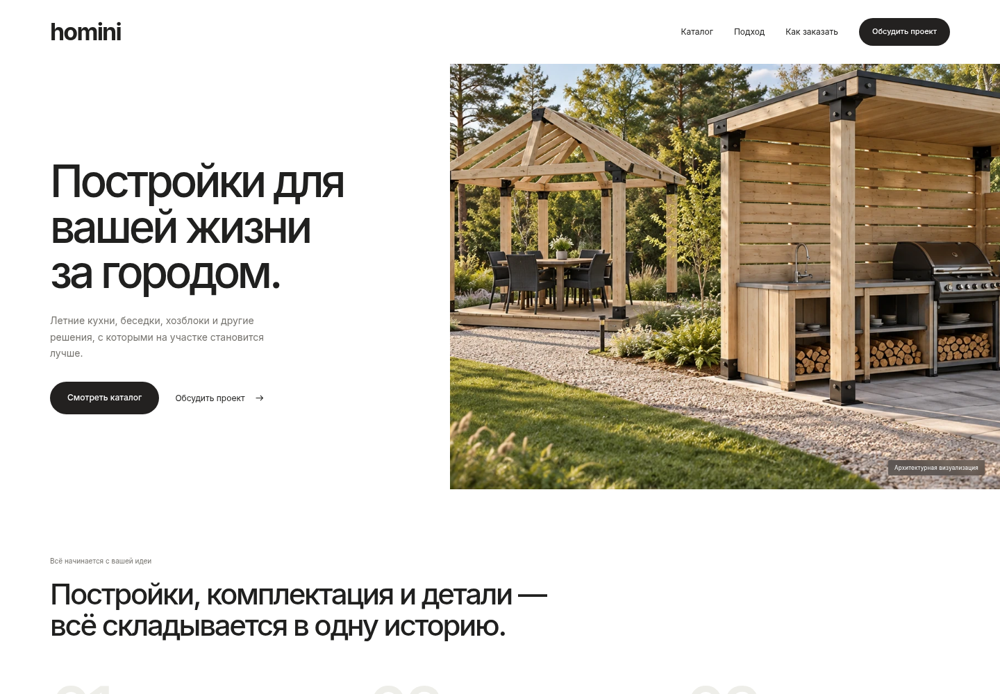

# 05 — Homini по референсу Clippings

Новый макет главной страницы по присланному референсу. **Дизайн работающего сайта не изменён.**

## Посмотреть

- **[Первый экран крупно](hero.png)**
- **[Вся страница](desktop.jpg)**
- **[Мобильный вариант](mobile.jpg)**

## Дизайн

- Настоящий локальный шрифт **Inter Variable**: заголовки средней насыщенности, обычный основной текст, без курсива.
- Белый фон, широкие отступы, сдержанная типографика и чёрные кнопки.
- Первый экран: текст слева, изображение справа.
- Три шага, светлый блок коллекции, каталог построек, общая сцена участка, графитовая секция и крупный план соединения.
- Использованы согласованные визуализации Homini. Блоки адаптированы под постройки; чужие логотипы, фотографии людей, программные интерфейсы и вымышленные реализованные проекты не перенесены.

Это изображения отдельного статического прототипа с реальным шрифтом и исходными WebP, а не сгенерированные картинки интерфейса. Кнопки и формы основного сайта пока не менялись.
