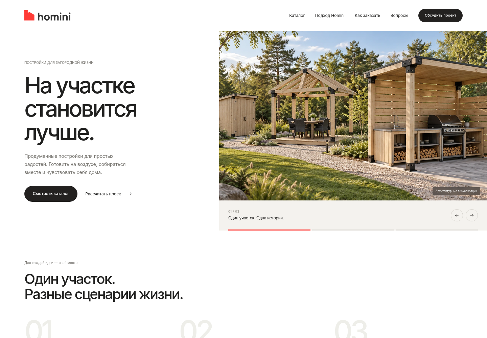

# 06 — Объединённый дизайн Homini

Согласованный вариант по референсу Clippings + содержание существующего сайта + ваш логотип + слайдер на первом экране.

**Этот вариант стал основой сайта. Текущая доработка с более читаемой типографикой и физическим свайпом: [07 — Apple Design](../07-apple-design/README.md). В подвале сохранена предоставленная белая версия логотипа.**

[Первый экран реализации](implemented-hero.jpg) · [Подвал с белым логотипом](implemented-footer.png)

Ниже сохранён согласованный макет для сравнения.

## Посмотреть макет

- **[Вся страница](desktop.jpg)**
- **[Мобильная версия](mobile.jpg)**
- **[Первый экран на телефоне](mobile-hero.png)**

## Три состояния первого экрана

1. **[Общий участок](hero-01.png)** — летняя кухня, беседка и хозблок.
2. **[Летняя кухня](hero-02.png)** — отдельный кадр кухни в саду.
3. **[Беседка](hero-03.png)** — пространство для отдыха.

Заголовок слева остаётся неподвижным. Справа меняются изображение и подпись. Предусмотрены стрелки, счётчик и три индикатора; активный отмечен красным цветом логотипа. В прототипе переключение ручное, без автопрокрутки.

## Что объединено

- **Из последнего дизайна:** настоящий Inter, белый фон, широкие отступы, спокойные заголовки без курсива, чёрные кнопки, тёплые серые и графитовые секции.
- **Из существующего сайта:** восемь категорий с фильтрами, подбор решения, подход Homini, детали, состав бюджета, пять этапов, FAQ и оформление формы заявки.
- **Новый логотип:** исходный SVG сохранён без изменения цветов и пропорций; применяется в шапке и подвале. [Открыть SVG](logo.svg).

## Попробовать слайдер

**[Скачать интерактивный прототип](prototype.zip)** → распакуйте архив → откройте `index.html` в браузере.

Шрифты и изображения включены в архив. Можно переключать слайды стрелками и индикаторами, пользоваться фильтрами и раскрывать FAQ. Форма демонстрационная: данные не отправляются и не сохраняются. Это архивный отдельный прототип. Рабочая реализация находится в основном коде сайта.
