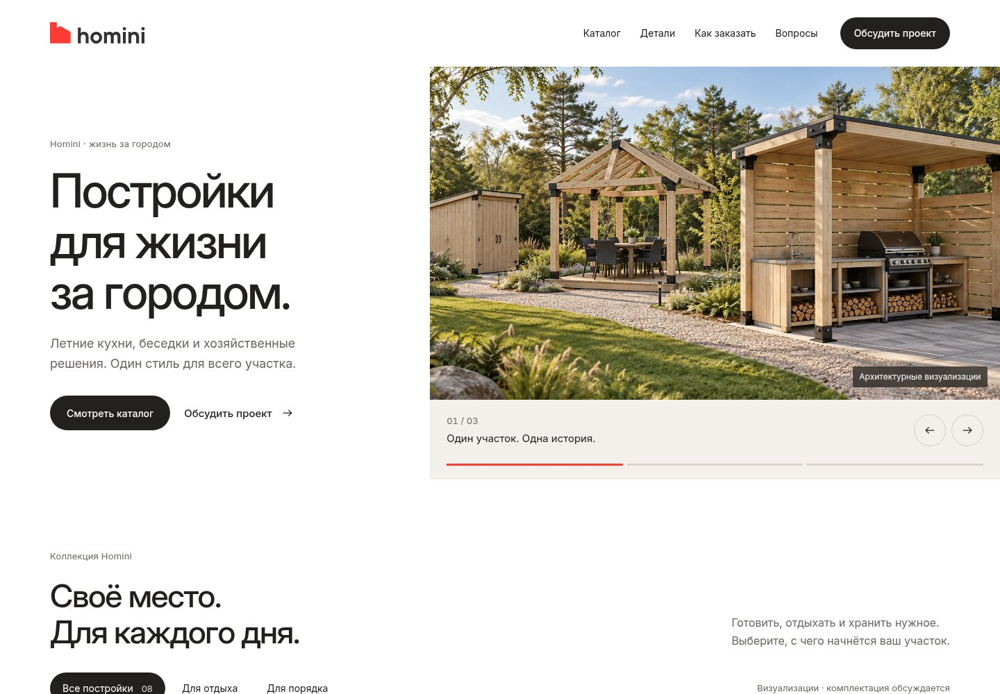

# 07 — Homini: доработка с Apple Design

[Открыть работающий сайт](https://mone-1999.github.io/homini-site/)

Реальные снимки собранного сайта после доработки по навыку Apple Design от Emil Kowalski. Это развитие согласованного макета 06: Inter, изображения и оригинальные логотипы сохранены.

- [Первый экран на компьютере](hero-desktop.jpg)
- [Первый экран на телефоне](hero-mobile.jpg)
- [Вся страница на компьютере](desktop.jpg)
- [Вся страница на телефоне](mobile.jpg)
- [Каталог](catalog.jpg)
- [Блок коннектора](details.jpg)
- [Форма заявки](contact.jpg)

Текст стал крупнее, трекинг заголовков — свободнее. Каталог следует за первым экраном, а блок соединения поднят сразу после каталога. Повтор общего баннера и длинное вступление убраны. Слайдер на Embla следует за пальцем, поддерживает смену направления, клавиатуру и уменьшенное движение. Выбор постройки передаётся в форму и сохраняется при повторном открытии подбора. Ошибки видны рядом с полями; поля и основные зоны нажатия увеличены.

Снимки не передают анимацию — свайп лучше смотреть на работающем сайте. Формы по-прежнему подготавливают письмо для самостоятельной отправки посетителем.
