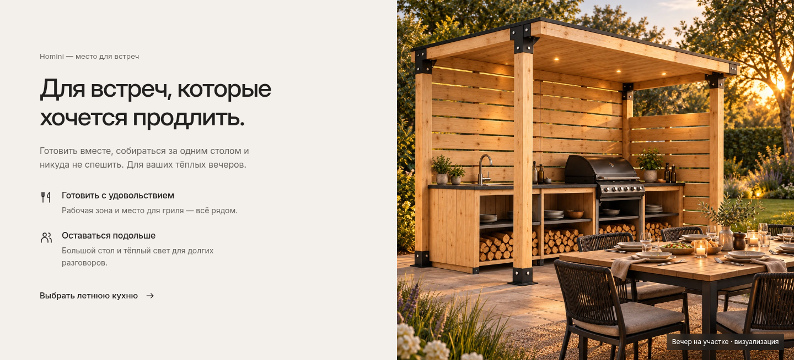

# 08 — Макет блока «Для встреч, которые хочется продлить»

Согласованная замена блока «Продумано до соединения» внедрена в рабочий сайт. Кнопка «Выбрать летнюю кухню» открывает подробности категории.

**[Открыть блок на сайте](https://mone-1999.github.io/homini-site/#details)**

- **[Открыть макет блока на компьютере](desktop.png)**
- **[Открыть мобильную версию](mobile.png)**
- **[Новое изображение летней кухни — PNG](kitchen-evening.png)**
- [Изображение в WebP](kitchen-evening.webp)

Сохранены две равные колонки, Inter, светлый фон, короткое описание, два пункта с линейными иконками и текстовая ссылка. Размер настольного макета — 1440 × 655 px, как у предоставленного примера по высоте. Справа — новая вечерняя визуализация на основе модели летней кухни из каталога Homini.

## Текст блока

Homini — место для встреч

**Для встреч, которые хочется продлить.**

Готовить вместе, собираться за одним столом и никуда не спешить. Для ваших тёплых вечеров.

**Готовить с удовольствием**  
Рабочая зона и место для гриля — всё рядом.

**Оставаться подольше**  
Большой стол и тёплый свет для долгих разговоров.

**Выбрать летнюю кухню →**

Подпись к изображению: «Вечер на участке · визуализация».
