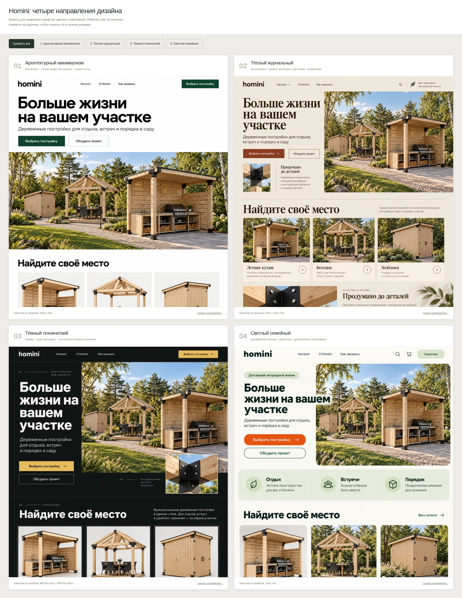
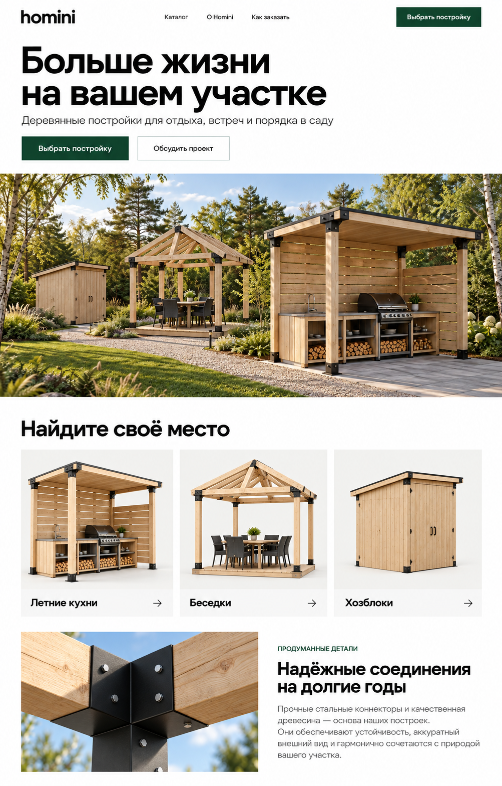
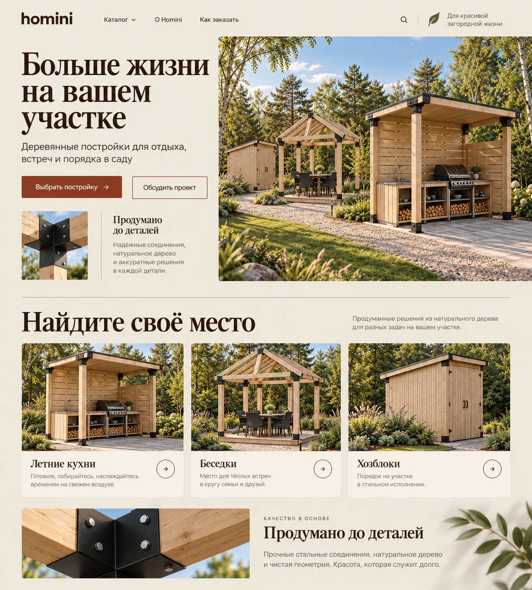
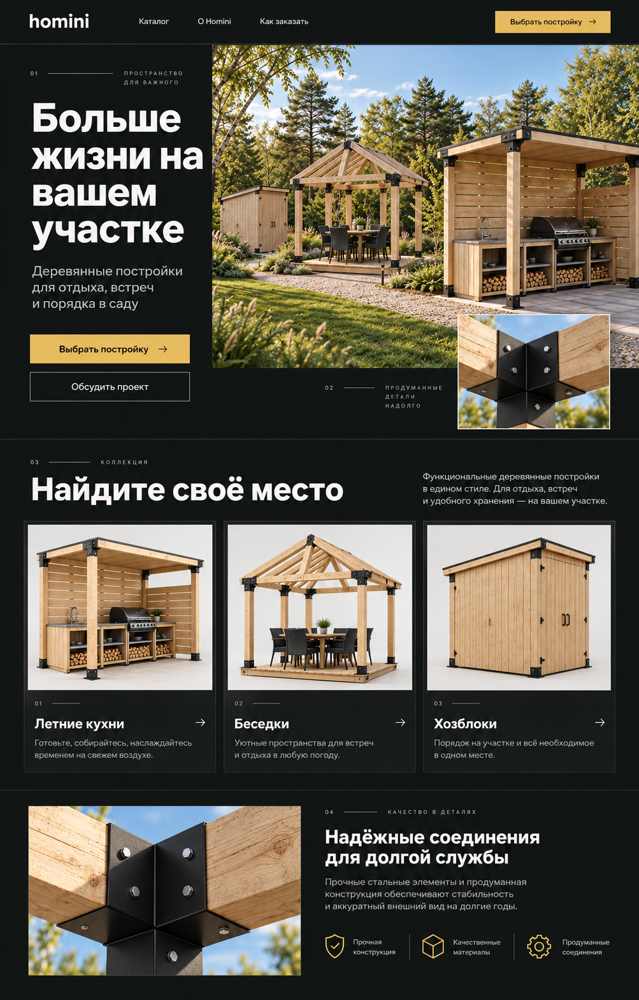
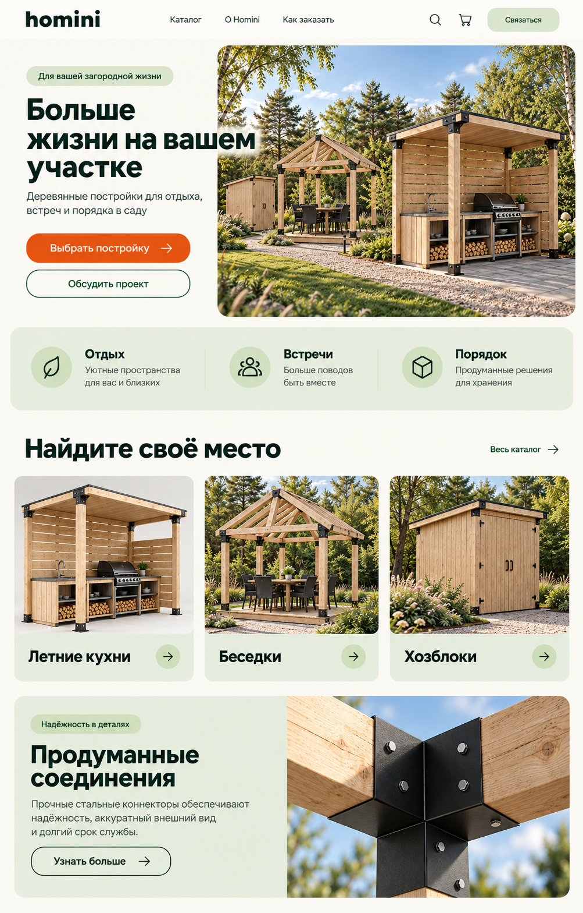

# Варианты дизайна Homini

Шесть визуальных концепций главной страницы для сравнения шрифтов, цветов и композиции.

**Последний макет: [06 — объединённый дизайн с вашим логотипом и слайдером](06-hybrid/README.md).**

**Новый вариант: [05 — по вашему референсу Clippings, со шрифтом Inter](05-reference/README.md).**

**В основном сайте реализован вариант 06: Inter, слайдер, ваши логотипы и минималистичные иконки. Остальные изображения здесь сохраняют варианты для сравнения.**

## Сравнить первые четыре варианта

[Открыть сравнение в полном размере](comparison.jpg)

## 01 — Архитектурный минимализм

Белый фон, крупная уверенная типографика без засечек, прямые формы и панорамное изображение. Ориентиры для реализации: Onest / Inter.

[Открыть макет в полном размере](01-architecture.png)

## 02 — Тёплый журнальный стиль

Льняные и коричневые оттенки, выразительные прямые заголовки с засечками и асимметричная композиция. Ориентиры: Prata + Golos Text.

[Открыть макет в полном размере](02-editorial.png)

## 03 — Тёмный технический

Графитовый фон, белые заголовки, охристый акцент и внимание к конструкции и соединениям. Ориентиры: IBM Plex Sans + IBM Plex Mono.

[Открыть макет в полном размере](03-technical.png)

## 04 — Светлый семейный

Светлый фон, шалфейный зелёный, оранжевая кнопка и мягкие скругления. Ориентир: Golos Text.

[Открыть макет в полном размере](04-friendly.png)

Это сгенерированные макеты для выбора визуального направления. Тексты и гарнитуры будут уточнены при реализации выбранного дизайна.
