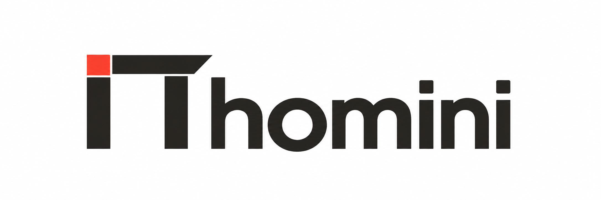
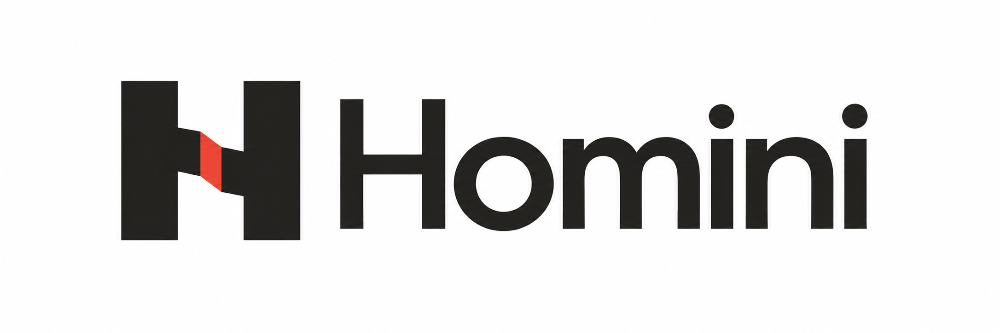
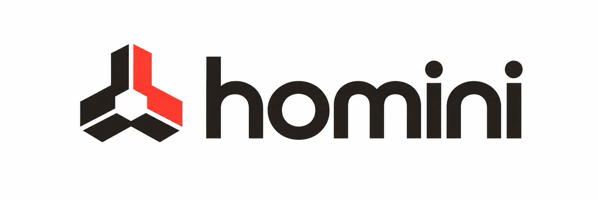
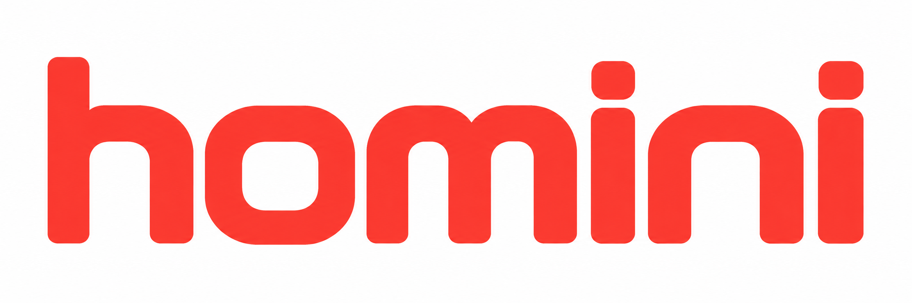

# Четыре варианта логотипа Homini

Откройте понравившееся изображение, чтобы рассмотреть его в полном размере. Варианты показаны на белом фоне; PNG с прозрачным фоном доступны в [папке transparent](transparent/).

## 01 — Портал

Архитектурный знак: стойки, балка и красный акцент в соединении.

[Открыть вариант 01](01-portal.png)

## 02 — Монограмма H

Буква H из двух опор с акцентом в месте соединения.

[Открыть вариант 02](02-monogram.png)

## 03 — Коннектор

Три элемента объединяются в один узел — отсылка к соединениям построек Homini.

[Открыть вариант 03](03-connector.png)

## 04 — Тёплая геометрия

Красный шрифтовой логотип с мягкими геометрическими буквами.

[Открыть вариант 04](04-wordmark.png)

Это растровые концепции для выбора направления. Рабочий логотип на сайте не заменён.
