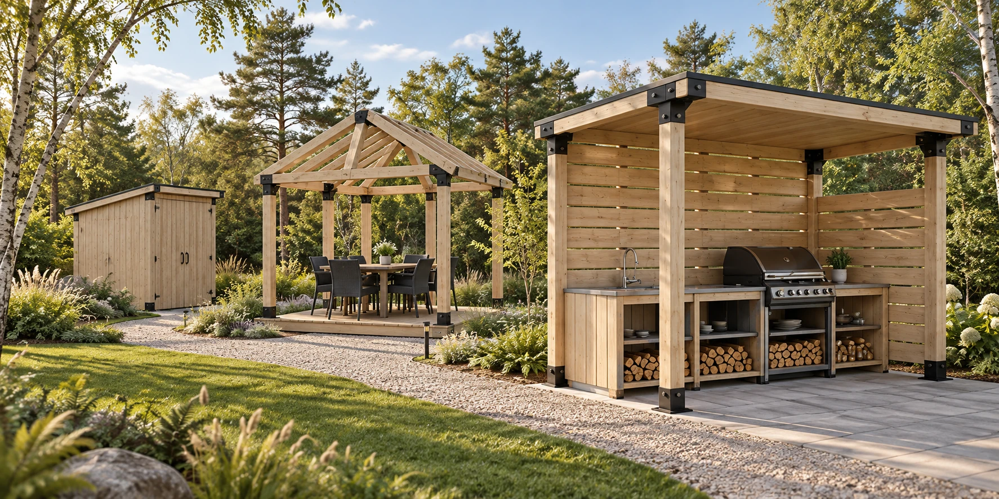
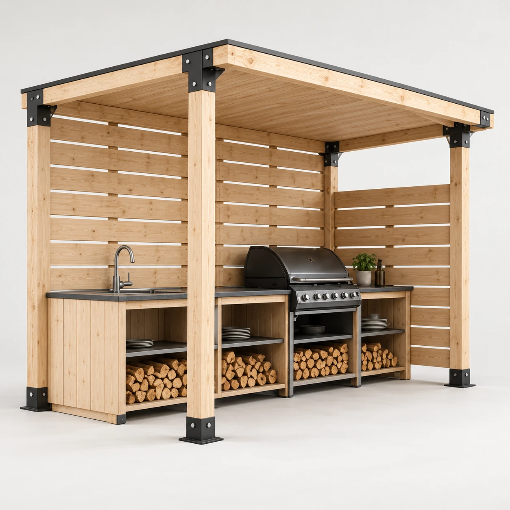
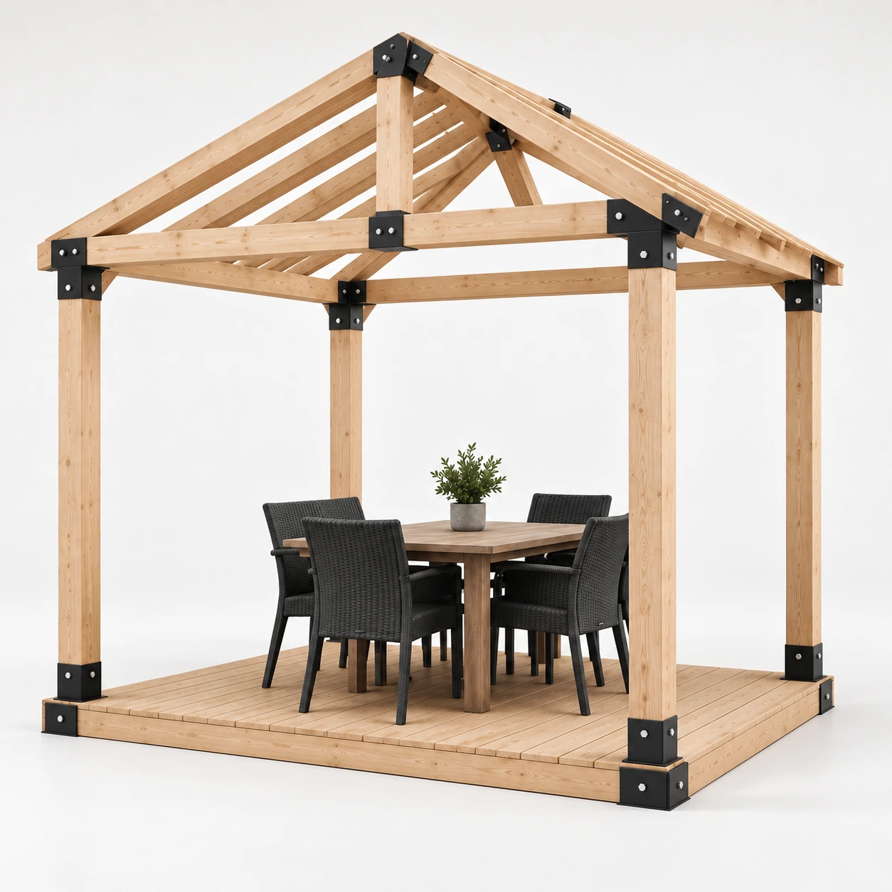
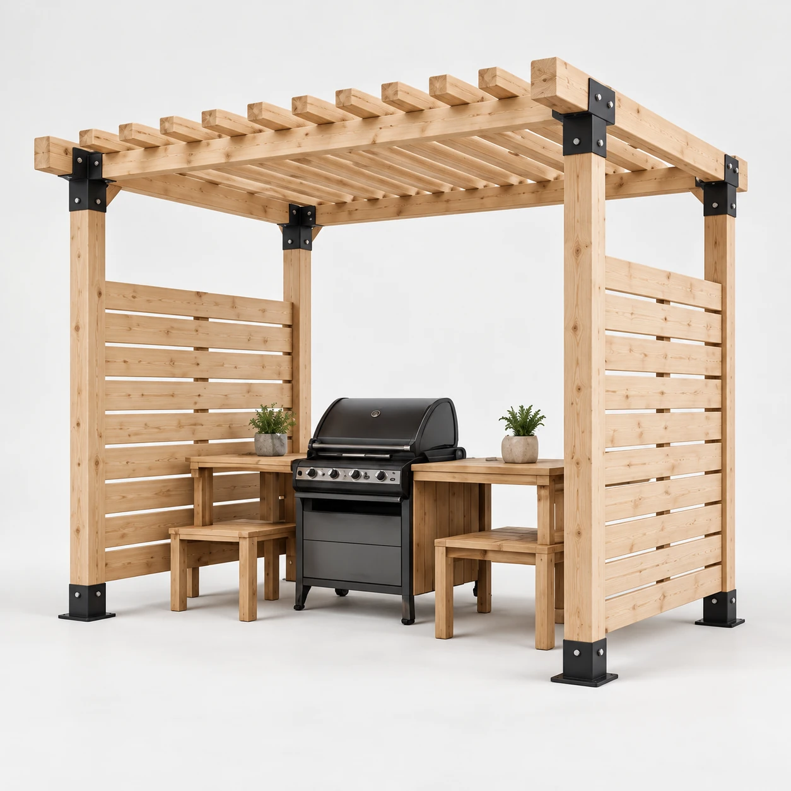
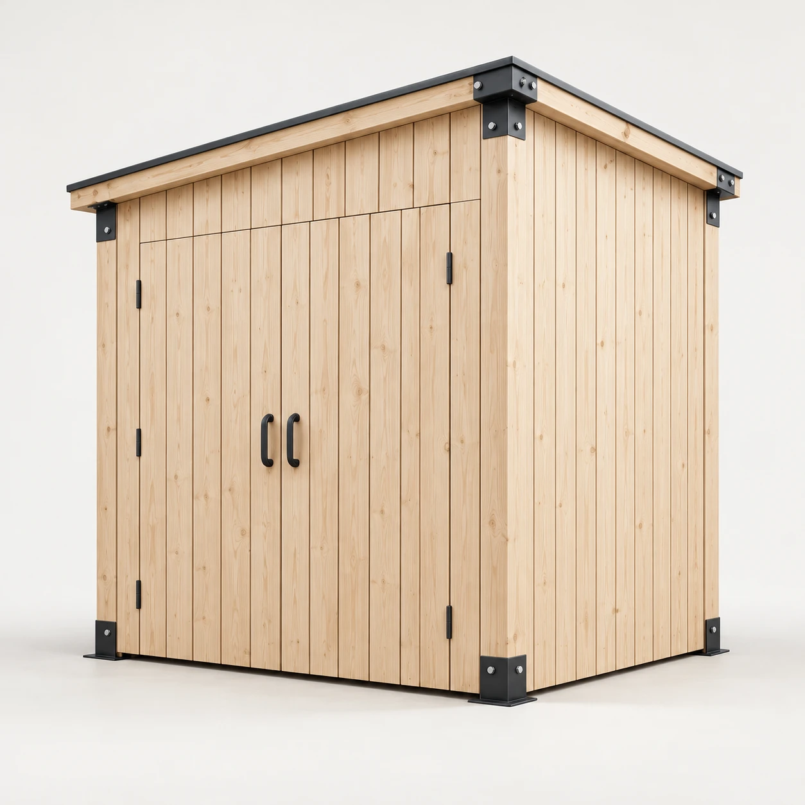
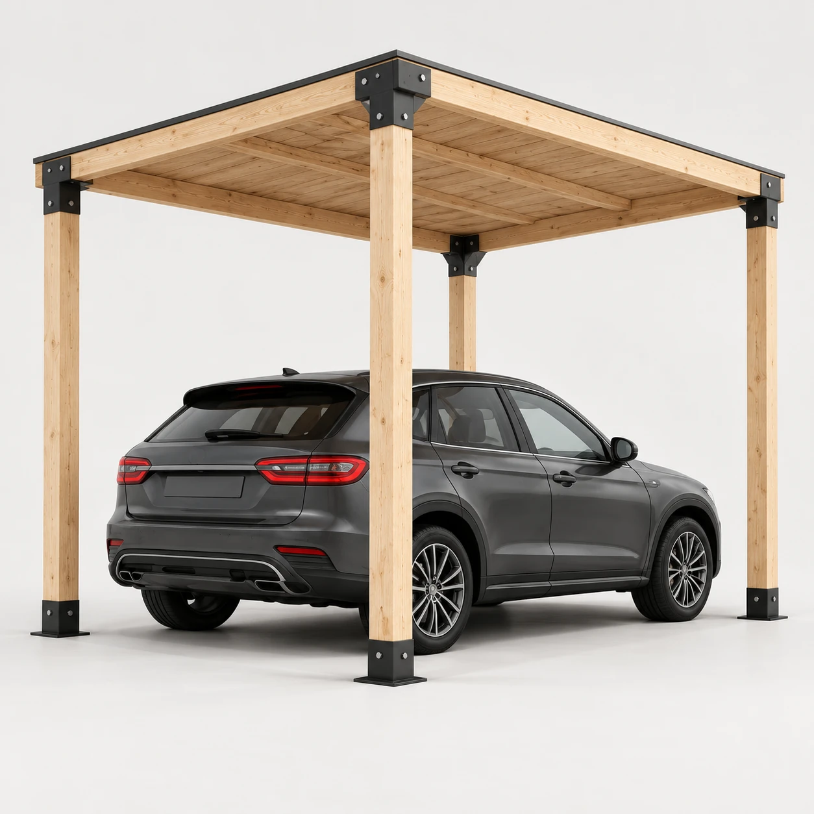
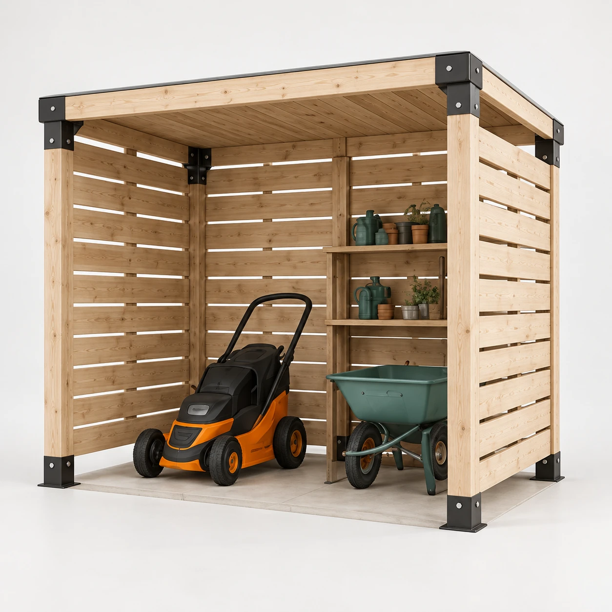
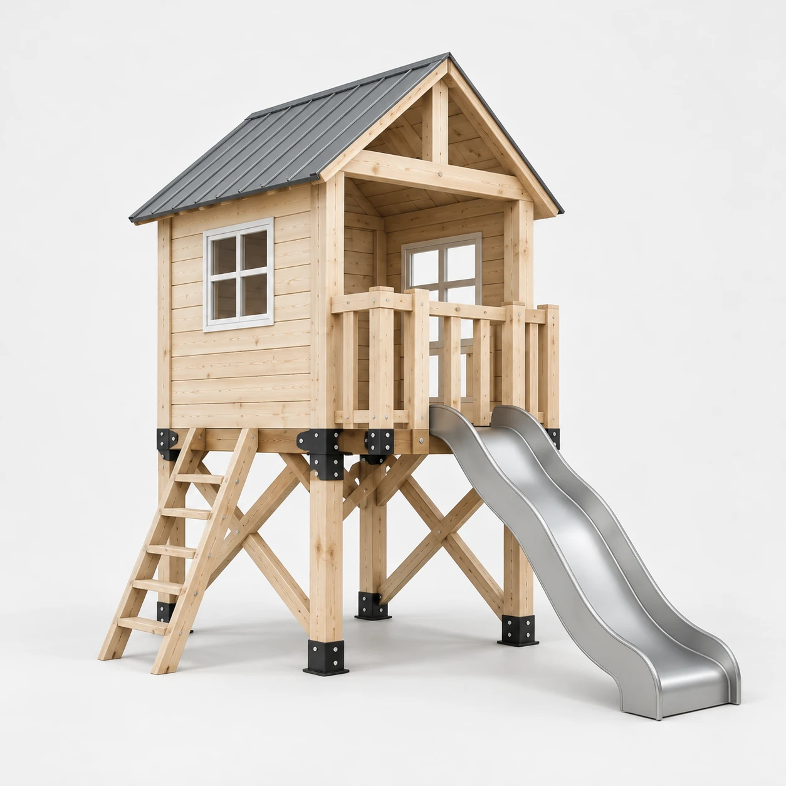
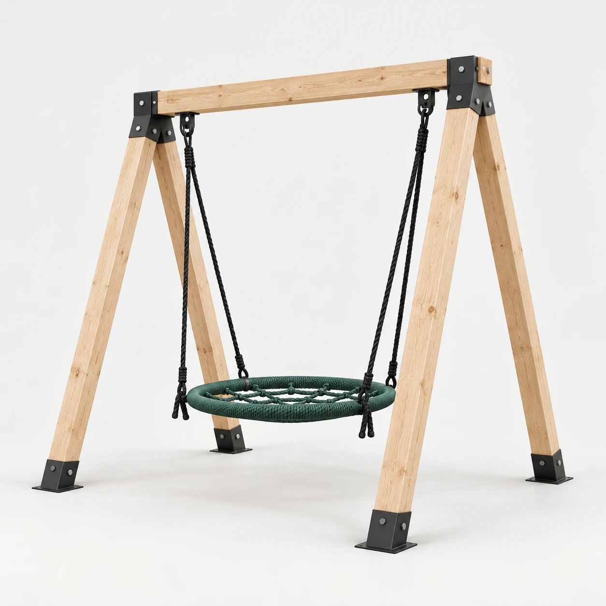
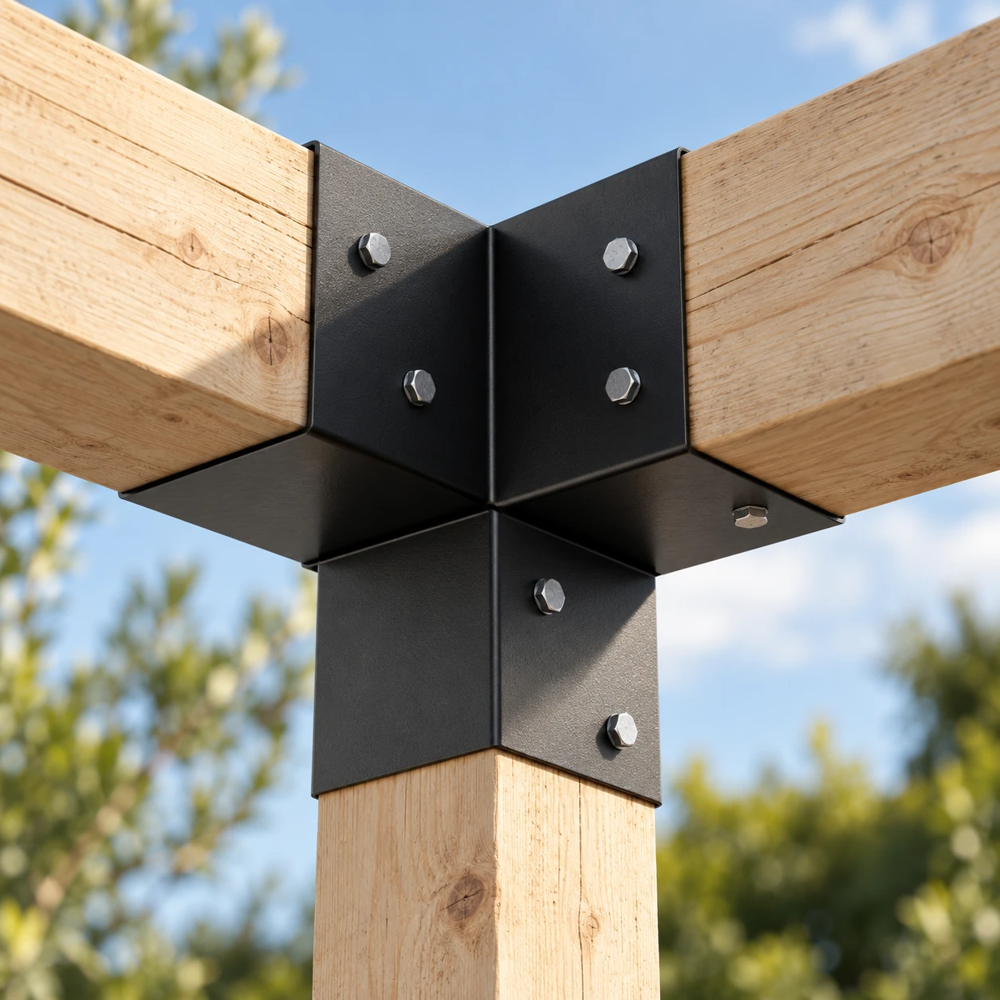

# Новые изображения Homini

Подборка подготовлена по вашим референсам построек и чёрных коннекторов. Все изображения — сгенерированные визуализации.

**[Открыть всю подборку одной картинкой](preview.png)** · **[Открыть главный баннер](banner-garden.webp)**

## Общий баннер: «Один участок — одна история»

Летняя кухня на переднем плане, беседка в центре, хозблок в глубине сада. Натуральное дерево и чёрные соединения объединяют постройки.

## Каталог на светлом фоне

### Летняя кухня

### Беседка

### Гриль-зона

### Хозблок

### Навес для автомобиля

### Для садовой техники

### Детский домик

### Качели

## Крупный план коннектора

Изображения размещены здесь для просмотра. Главная страница сайта пока использует прежние изображения.
